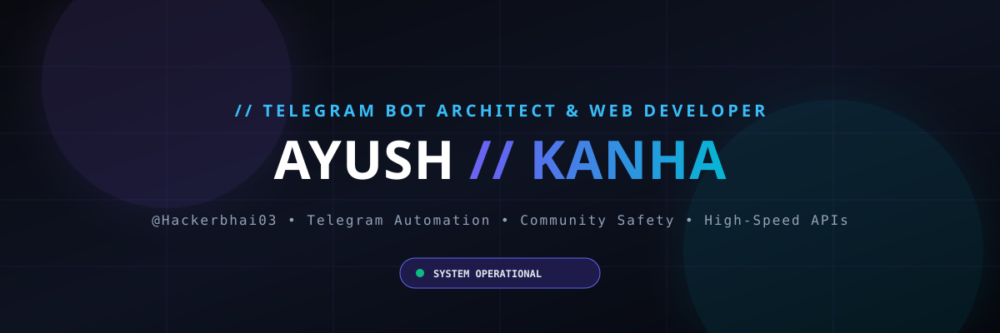

# ⚡ Ayush (Kanha) — Cyberpunk Developer Portfolio

<div align="center">



[](https://opensource.org/licenses/MIT)
[](https://nodejs.org)
[](https://vitejs.dev)
[](https://tailwindcss.com)
[](https://heroku.com)
[](https://t.me/KingxAra)

<p align="center">
  <strong>Elite Cyberpunk Developer Portfolio for Ayush, also known as Kanha (@Hackerbhai03).</strong><br>
  Built with React 19, Vite, Tailwind CSS v4, Lucide Icons, Canvas Matrix Rain, Synthesized Web Audio, and Express.
</p>

[Explore Live](#) • [Report Issue](https://github.com/Hackerbhai03/about-ayush/issues) • [Telegram Direct](https://t.me/KingxAra)

</div>

---

## 🌟 Highlights & Features

- 🛸 **Cyberpunk Aesthetics & Glows**: Ambient neon gradients, high-tech grid matrix, scanlines, and glassmorphic cards.
- ⚡ **Interactive Cyber CLI Terminal**: Real interactive bash shell (`kanha@system:~$`) with commands like `help`, `skills`, `projects`, `bots`, `matrix`, `sudo`, `kanha`, and command history navigation.
- 🟢 **Matrix Rain Engine**: Interactive full-screen digital rain canvas protocol.
- 🔊 **Synthesized Tactile Audio**: Ultra-crisp mechanical typing and sci-fi chirps powered by native Web Audio API (zero external audio file dependencies).
- 🤖 **Telegram Bots Hub & Command Tester**: Live showcase of Telegram bot ecosystem (`@PurviBots`, `@Purvi_Bots`, `@KingxAra`) with an interactive command simulator.
- 🛡️ **Anti-Abuse & Community Safety**: Highlighted moral commitment to tracking and taking down malicious channels targeting individuals and privacy.
- 📱 **100% Fully Responsive**: Pixel-perfect across ultra-wide monitors, laptops, tablets, and smartphones.
- 🚀 **Deploy Anywhere**: Pre-configured for **Heroku** (`Procfile` + `server.js`), **Vercel** (`vercel.json`), **Render**, and static hosts.

---

## 🛠️ Tech Stack

- **Frontend**: React 19, Vite, Tailwind CSS v4, Canvas Confetti
- **Audio Synthesis**: Native Web Audio API
- **Production Server**: Node.js & Express 5 (SPA static fallback)
- **Deployment Targets**: Heroku Dynos (`npm start`), Vercel, Docker

---

## 🚀 Quick Start (Local Development)

```bash
# Clone the repository
git clone https://github.com/Hackerbhai03/about-ayush.git
cd about-ayush

# Install dependencies
npm install

# Start local development server (with HMR)
npm run dev
```

Visit `http://localhost:3000` in your browser.

---

## 📦 Production Build & Testing

```bash
# Build optimized production bundle
npm run build

# Start production Express server
npm start
```

---

## ☁️ Deployment

### 1. Deploying to Heroku

This repo contains a native `Procfile` and Express production `server.js`:

```bash
# Login to Heroku
heroku login

# Create Heroku App
heroku create your-portfolio-name

# Deploy
git push heroku main

# Open app
heroku open
```

### 2. Deploying to Vercel

Configured automatically via `vercel.json`:

```bash
npx vercel --prod
```

---

## 👤 Author & Credits

- **Name**: Ayush
- **Also Known As**: Kanha
- **GitHub**: [@Hackerbhai03](https://github.com/Hackerbhai03)
- **Telegram**: [@KingxAra](https://t.me/KingxAra) | Channel: [@PurviBots](https://t.me/PurviBots)
- **Instagram**: [@careless__02](https://www.instagram.com/careless__02/)

---

<p align="center">
  Curious first, expert later. Built with ❤️ and code.
</p>
